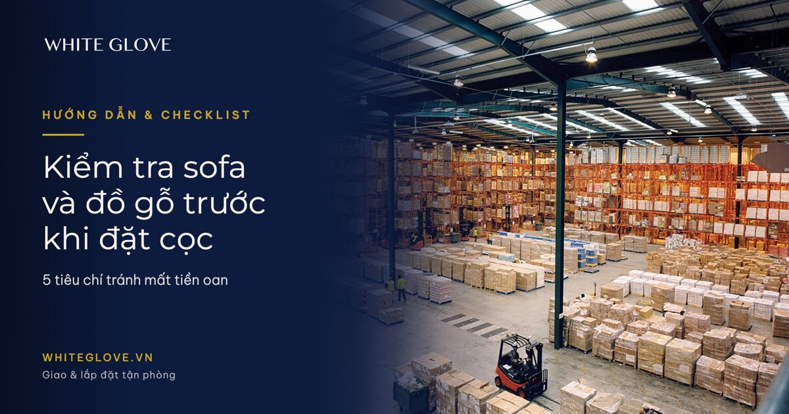

> Trả lời nhanh: Trước khi đặt cọc sofa và đồ gỗ, hãy kiểm tra 5 nhóm sau. (1) Khung xương: gỗ cứng, mộng âm dương, không dùng gỗ tạp ép ván. (2) Đệm và nhồi: mật độ mút, độ đàn hồi, lò xo túi. (3) Da và vải bọc: độ dày, đường chỉ, màu đều, không mùi hóa chất. (4) Kết cấu đồ gỗ: mộng, keo, mặt phẳng, độ ẩm gỗ, lớp hoàn thiện. (5) Chứng từ và bảo hành: xuất xứ, hóa đơn, điều khoản bảo hành, condition report khi nhận. Kiểm tra trực tiếp tại showroom hoặc qua video call có người đại diện, đừng chỉ xem ảnh mẫu. Đặt cọc tối thiểu, ghi rõ điều kiện hoàn cọc nếu hàng không đúng mô tả.

## Kiểm tra chất lượng sofa và đồ gỗ thế nào trước khi đặt cọc?

Câu trả lời ngắn gọn: hãy kiểm tra theo 5 tiêu chí dưới đây, mỗi tiêu chí đều có dấu hiệu nhận biết cụ thể để bạn không phải đánh đổi bằng cảm tính. Với hàng nhập khẩu, tiêu chí thứ năm là chứng từ còn quan trọng hơn cả bốn tiêu chí đầu, vì nó quyết định bạn có được bảo vệ khi hàng về muộn, hư hỏng hoặc sai mô tả hay không.

### Tiêu chí 1: Khung xương sofa và đồ gỗ

Khung xương là phần quyết định tuổi thọ của sofa, nhưng lại là phần khó thấy nhất khi xem hàng. Hãy yêu cầu người bán lật úp sofa hoặc mở phần vải bọc dưới đáy để xem trực tiếp.

- Gỗ cứng tự nhiên: sồi, tần bì, cao su già là nhóm phổ biến và bền. Tránh khung làm từ ván ép, MDF hoặc gỗ tạp ghép đinh.
- Mộng và keo: các mối nối phải dùng mộng âm dương, chốt gỗ hoặc vít gia cường, không chỉ đóng đinh và dán keo.
- Độ rung khi lắc: đặt sofa xuống sàn phẳng, lắc nhẹ hai tay vịn. Khung tốt gần như không phát ra tiếng kẽo kẹt.
- Góc cạnh: các góc khung phải vuông, không nứt, không có dấu hiệu mối mọt hoặc ẩm mốc.

### Tiêu chí 2: Đệm, nhồi và hệ lò xo

Đệm quyết định cảm giác ngồi và khả năng giữ form sau nhiều năm. Đây là phần dễ bị đánh tráo nhất giữa hàng mẫu và hàng giao thực tế, nên cần ghi rõ trong hợp đồng.

- Mật độ mút: sofa cao cấp thường dùng mút có mật độ cao, ấn tay vào thấy đàn hồi nhanh, không lún vĩnh viễn.
- Lò xo túi: hệ lò xo túi độc lập cho cảm giác êm và ít lún hơn lò xo xoắn liên kết.
- Lớp lót và vải bọc trong: có lớp vải lót bảo vệ đệm, không lộ mút thô hoặc keo dính.
- Độ dày đệm: đệm quá mỏng thường là dấu hiệu cắt giảm chi phí, ngồi lâu sẽ lún và mất form.

### Tiêu chí 3: Da và vải bọc

Da và vải là bề mặt tiếp xúc trực tiếp, cũng là nơi dễ phát hiện hàng kém chất lượng nhất nếu bạn biết cách quan sát.

- Da thật: mặt da có lỗ chân lông tự nhiên, mùi da nhẹ, khi ấn nhẹ thấy vân da đàn hồi. Da công nghiệp thường đều màu một cách bất thường và có mùi nhựa.
- Đường chỉ: chỉ phải đều, thẳng, không lỏng, không thừa chỉ. Đường may lệch là dấu hiệu gia công ẩu.
- Màu sắc: kiểm tra dưới ánh sáng tự nhiên, tránh ánh đèn vàng trong showroom làm sai màu thực tế.
- Vải bọc: hỏi rõ thành phần, định lượng và khả năng chống bám bẩn. Vải kém thường mỏng, dễ xước và nhanh xù lông.

### Tiêu chí 4: Kết cấu và hoàn thiện đồ gỗ

Với đồ gỗ, hãy kiểm tra như một người thợ: nhìn mộng, sờ mặt phẳng, ngửi mùi và đo độ ẩm. Đây là cách đánh giá đồ gỗ Trung Quốc hoặc đồ gỗ nhập khẩu nói chung mà không cần máy móc chuyên dụng.

- Mộng và liên kết: ưu tiên mộng âm dương, mộng hộp, chốt gỗ. Hạn chế đồ gỗ chỉ dùng vít và keo ở các khớp chịu lực.
- Mặt phẳng: dùng thước hoặc cạnh thẳng áp lên mặt bàn, mặt cánh tủ để kiểm tra cong vênh.
- Độ ẩm gỗ: gỗ có độ ẩm cao dễ nứt, cong khi về khí hậu Việt Nam. Hỏi nhà cung cấp về quy trình sấy.
- Lớp hoàn thiện: sơn PU hoặc veneer phải phẳng, không rỗ, không bong mép, không có mùi dung môi nồng.

### Tiêu chí 5: Chứng từ, bảo hành và điều kiện đặt cọc

Đây là tiêu chí thường bị bỏ qua nhất nhưng lại bảo vệ bạn nhiều nhất. Hàng nội thất nhập khẩu cao cấp có giá trị lớn, nên mọi cam kết phải nằm trên giấy.

- Nguồn gốc xuất xứ: yêu cầu hóa đơn, chứng từ nhập khẩu, thông tin nhà sản xuất. Với hàng từ châu Âu, nhà xuất khẩu dùng tự chứng nhận xuất xứ theo hệ thống REX, không phải xin C/O mẫu EUR.1 cho chiều EU về Việt Nam.
- Điều khoản bảo hành: thời hạn, phạm vi, đơn vị thực hiện bảo hành tại Việt Nam, thời gian xử lý.
- Điều kiện hoàn cọc: ghi rõ trường hợp hàng sai mô tả, giao trễ, hư hỏng thì hoàn cọc bao nhiêu phần trăm.
- Mức đặt cọc: chỉ nên đặt cọc ở mức đủ giữ hàng, không nên chuyển toàn bộ giá trị trước khi kiểm tra hàng thực tế.

Nếu bạn đang nhập nội thất theo lô hoặc theo dự án, việc kiểm tra chứng từ nên đi kèm với quy trình nhập khẩu bài bản. Bạn có thể tham khảo [hướng dẫn nhập nội thất Trung Quốc A→Z](https://whiteglove.vn/blog/huong-dan-nhap-noi-that-trung-quoc-a-z/) để nắm các bước kiểm tra trước khi hàng lên đường.

## Vì sao nên kiểm tra qua đơn vị vận chuyển chuyên nghiệp trước khi đặt cọc?

Kiểm tra qua đơn vị vận chuyển chuyên nghiệp giúp bạn có bên thứ ba ghi nhận tình trạng hàng, thay vì chỉ tin vào lời người bán. Với hàng nhập khẩu, phần lớn rủi ro phát sinh sau khi đặt cọc: hàng về muộn, hư hỏng khi vận chuyển, sai màu hoặc thiếu phụ kiện.

White Glove Logistics hỗ trợ khách hàng cao cấp ở đúng điểm này: giao tận phòng, lắp đặt tại chỗ, bảo hiểm hàng hóa và condition report ghi nhận tình trạng thực tế khi bàn giao. Bạn có thể xem [báo giá vận chuyển nội thất nhập khẩu](https://whiteglove.vn/blog/bao-gia-van-chuyen-noi-that-nhap-khau/) để hình dung chi phí trước khi quyết định. Nếu bạn chưa quen quy trình, bài [ủy thác nhập khẩu là gì](https://whiteglove.vn/blog/uy-thac-nhap-khau-la-gi/) sẽ giúp bạn hiểu rõ vai trò của đơn vị nhập khẩu ủy thác.

Đừng đặt cọc chỉ vì ảnh đẹp. Hãy yêu cầu kiểm tra thực tế, ghi rõ điều kiện trong hợp đồng và chọn đơn vị vận chuyển có quy trình bàn giao minh bạch. [nhận báo giá](https://whiteglove.vn/bang-gia.html) để được tư vấn phương án vận chuyển và bảo hiểm phù hợp với lô hàng của bạn.

## Câu hỏi thường gặp

### Nên kiểm tra sofa trước khi đặt cọc ở đâu?

Nên kiểm tra tại showroom hoặc kho hàng thực tế. Nếu mua từ xa, hãy yêu cầu video call trực tiếp có người đại diện bên bán và ghi lại làm bằng chứng kèm hợp đồng.

### Đặt cọc bao nhiêu phần trăm là hợp lý?

Mức đặt cọc hợp lý thường đủ để giữ hàng và thể hiện thiện chí, nhưng không nên chuyển toàn bộ giá trị trước khi kiểm tra hàng thực tế. Điều kiện hoàn cọc cần ghi rõ trong hợp đồng.

### Làm sao đánh giá đồ gỗ Trung Quốc chất lượng?

Hãy kiểm tra mộng, độ ẩm gỗ, mặt phẳng và lớp hoàn thiện. Đồ gỗ tốt dùng mộng âm dương hoặc mộng hộp, không cong vênh, không mùi dung môi nồng và có chứng từ nguồn gốc rõ ràng.

### Hàng nội thất từ châu Âu cần chứng từ gì?

Hàng EU nhập vào Việt Nam dùng tự chứng nhận xuất xứ theo hệ thống REX. Lô dưới 6.000 EUR có thể do bất kỳ nhà xuất khẩu tự chứng nhận, lô trên 6.000 EUR cần nhà xuất khẩu đã đăng ký REX. Không áp dụng C/O mẫu EUR.1 cho chiều EU về Việt Nam.

### Condition report có cần thiết khi nhận hàng không?

Rất cần. Condition report ghi nhận tình trạng hàng tại thời điểm bàn giao, là căn cứ để xử lý bảo hiểm và khiếu nại nếu hàng hư hỏng hoặc sai mô tả.

Nguồn ảnh: hero: Ảnh: Axisadman (CC BY-SA 3.0); Nick Saltmarsh (CC BY 2.0); Gilgen Logistics AG (CC BY-SA 4.0); Cjp24 (CC BY-SA 3.0) / Wikimedia Commons | support: Ảnh: Axisadman (CC BY-SA 3.0); Nick Saltmarsh (CC BY 2.0); Gilgen Logistics AG (CC BY-SA 4.0); Cjp24 (CC BY-SA 3.0) / Wikimedia Commons | support2: Ảnh: Axisadman (CC BY-SA 3.0); Nick Saltmarsh (CC BY 2.0); Gilgen Logistics AG (CC BY-SA 4.0); Cjp24 (CC BY-SA 3.0) / Wikimedia Commons
