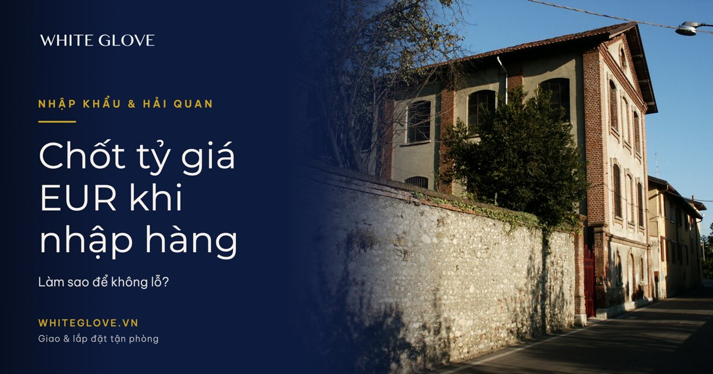
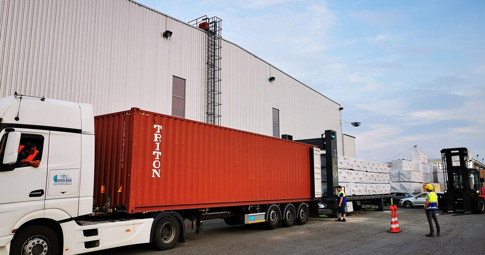

> Trả lời nhanh: Để không lỗ khi đặt hàng xưởng Ý thanh toán EUR, bạn cần chốt tỷ giá ngay từ lúc ký hợp đồng bằng một trong ba cách: (1) thỏa thuận tỷ giá cố định với xưởng và ghi rõ trong hợp đồng, (2) mua ngoại tệ kỳ hạn với ngân hàng để khóa tỷ giá EUR/VND, (3) dùng điều khoản chia sẻ rủi ro tỷ giá nếu biến động vượt ngưỡng. Luôn cộng thêm biên an toàn 2-4% vào giá bán và theo dõi tỷ giá EUR/VND trong suốt thời gian từ lúc đặt cọc đến lúc thanh toán nốt. Với hàng nội thất cao cấp, rủi ro tỷ giá chỉ xuất hiện khi nhập ngoài Trung Quốc — đây là điểm khác biệt lớn so với hàng Trung Quốc thanh toán bằng Nhân dân tệ.

## Vì sao đặt hàng xưởng Ý thanh toán bằng EUR lại có rủi ro tỷ giá?

Đặt hàng xưởng Ý thanh toán bằng EUR có rủi ro tỷ giá vì giá trị đơn hàng thường lớn, thời gian sản xuất và vận chuyển kéo dài nhiều tháng, trong khi tỷ giá EUR/VND biến động hàng ngày. Khác với hàng Trung Quốc thanh toán bằng Nhân dân tệ hoặc USD, hàng Ý bắt buộc thanh toán bằng EUR — đồng tiền chịu ảnh hưởng bởi chính sách tiền tệ của Ngân hàng Trung ương châu Âu và diễn biến kinh tế toàn cầu.

Với một bộ sofa da cao cấp trị giá vài chục nghìn EUR, chỉ cần tỷ giá EUR/VND tăng 3-5% trong 3-6 tháng là bạn có thể mất hàng chục triệu đồng lợi nhuận. Đây là lý do vì sao chốt tỷ giá nhập khẩu là bước không thể bỏ qua khi nhập khẩu nội thất từ châu Âu.

### Rủi ro tỷ giá chỉ xuất hiện khi nhập ngoài Trung Quốc

Hàng Trung Quốc thường thanh toán bằng Nhân dân tệ hoặc USD với chu kỳ sản xuất ngắn, nhiều xưởng nhận thanh toán linh hoạt. Trong khi đó, hàng Ý, Pháp, Đức bắt buộc thanh toán bằng EUR, thời gian sản xuất nội thất cao cấp có thể 8-16 tuần, cộng thêm 4-8 tuần vận chuyển biển. Tổng chu kỳ từ lúc đặt cọc đến lúc nhận hàng có thể 4-6 tháng — đủ để tỷ giá EUR/VND thay đổi đáng kể.

## Chốt tỷ giá khi đặt hàng xưởng Ý thanh toán bằng EUR như thế nào?

Chốt tỷ giá khi đặt hàng xưởng Ý thanh toán bằng EUR là việc xác định trước một mức tỷ giá EUR/VND cho toàn bộ hoặc từng phần giá trị đơn hàng, để khóa chi phí nhập khẩu và bảo vệ biên lợi nhuận. Dưới đây là quy trình 5 bước thực tế mà các nhà nhập khẩu nội thất cao cấp đang áp dụng.

### Bước 1: Xác định tổng giá trị EUR và dòng tiền thanh toán

Trước khi chốt tỷ giá, bạn cần biết chính xác tổng giá trị đơn hàng bằng EUR và lịch thanh toán. Thông thường xưởng Ý yêu cầu đặt cọc 30-50% khi ký hợp đồng, thanh toán nốt trước khi giao hàng hoặc sau khi nhận bộ chứng từ. Mỗi mốc thanh toán là một lần bạn phải mua EUR, nên hãy lập bảng dòng tiền theo từng mốc để biết chính xác khi nào cần khóa tỷ giá.

### Bước 2: Chọn công cụ chốt tỷ giá phù hợp

Có ba cách chốt tỷ giá phổ biến, mỗi cách có ưu nhược điểm riêng:

- Hợp đồng kỳ hạn ngoại tệ với ngân hàng: Khóa tỷ giá EUR/VND cho một ngày thanh toán cụ thể trong tương lai. Ưu điểm là chắc chắn chi phí, nhược điểm là cần ký quỹ và không linh hoạt nếu lịch giao hàng thay đổi.
- Mua ngoại tệ giao ngay và giữ trong tài khoản: Phù hợp khi bạn có sẵn tiền đồng và muốn chốt ngay tại thời điểm tỷ giá có lợi. Rủi ro là phải quản lý ngoại tệ và chịu phí chuyển đổi.
- Thỏa thuận tỷ giá cố định với xưởng: Một số xưởng Ý chấp nhận ghi tỷ giá cố định trong hợp đồng nếu bạn thanh toán sớm. Cách này đơn giản nhưng cần đàm phán và thường chỉ áp dụng cho đơn hàng lớn, quan hệ lâu năm.

### Bước 3: Ghi rõ điều khoản tỷ giá trong hợp đồng nhập khẩu

Hợp đồng với xưởng Ý cần ghi rõ đồng tiền thanh toán là EUR, tỷ giá quy đổi nếu có, và điều khoản xử lý khi tỷ giá biến động vượt ngưỡng. Nếu chưa chốt được tỷ giá cố định, hãy thêm điều khoản chia sẻ rủi ro: ví dụ nếu tỷ giá EUR/VND biến động quá 3% so với ngày ký, hai bên cùng điều chỉnh giá. Điều khoản này giúp tránh tranh chấp và bảo vệ cả hai bên.

### Bước 4: Cộng biên an toàn vào giá bán

Dù đã chốt tỷ giá, bạn vẫn nên cộng thêm biên an toàn 2-4% vào giá bán lẻ để phòng trường hợp tỷ giá biến động ngoài dự kiến hoặc phát sinh chi phí. Với nội thất cao cấp, biên an toàn này thường không ảnh hưởng đến sức cạnh tranh vì khách hàng mua sản phẩm Ý chủ yếu quan tâm đến chất lượng và dịch vụ.

### Bước 5: Theo dõi tỷ giá EUR/VND và chốt từng phần

Không cần chốt toàn bộ đơn hàng trong một lần. Bạn có thể chia nhỏ và chốt tỷ giá theo từng mốc thanh toán, hoặc chốt một phần khi tỷ giá có lợi và phần còn lại theo dõi tiếp. Chiến lược trung bình giá giúp giảm rủi ro và tận dụng biến động ngắn hạn. Theo dõi tỷ giá EUR/VND trên trang của ngân hàng hoặc Ngân hàng Nhà nước để có quyết định kịp thời.

## Thanh toán EUR nhập hàng: những sai lầm khiến bạn lỗ

Thanh toán EUR nhập hàng có thể khiến bạn lỗ nếu mắc các sai lầm phổ biến dưới đây. Đây là những lỗi mà nhiều nhà nhập khẩu nội thất lần đầu làm việc với xưởng Ý thường gặp.

- Không ghi tỷ giá trong hợp đồng: Đến lúc thanh toán mới mua EUR, tỷ giá tăng là lỗ ngay trên phần chênh lệch.
- Chỉ chốt tỷ giá cho tiền đặt cọc: Phần thanh toán nốt chiếm 50-70% giá trị đơn hàng, nếu không chốt tiếp thì rủi ro vẫn còn nguyên.
- Không tính phí chuyển tiền quốc tế: Phí wire transfer, phí trung gian ngân hàng có thể 0,1-0,3% giá trị, cộng vào làm tăng chi phí thực tế.
- Bỏ qua thời gian vận chuyển: Từ lúc thanh toán nốt đến lúc hàng về Việt Nam có thể 6-10 tuần, tỷ giá có thể biến động trong khoảng này nếu bạn chưa khóa.

Để tránh các sai lầm này, nhiều doanh nghiệp chọn dịch vụ ủy thác nhập khẩu trọn gói, trong đó đơn vị nhập khẩu chịu trách nhiệm về tỷ giá và thủ tục. Bạn có thể tham khảo [ủy thác nhập khẩu là gì](https://whiteglove.vn/blog/uy-thac-nhap-khau-la-gi/) để hiểu rõ hơn về mô hình này.

## White Glove Logistics hỗ trợ chốt tỷ giá và vận chuyển nội thất Ý về Việt Nam

White Glove Logistics hỗ trợ chốt tỷ giá và vận chuyển nội thất Ý về Việt Nam bằng quy trình trọn gói từ xưởng đến phòng khách của bạn. Chúng tôi hiểu rằng hàng nội thất cao cấp không chỉ là món hàng mà là khoản đầu tư lớn, nên mọi khâu từ thanh toán EUR, thông quan đến giao nhận đều cần kiểm soát chặt chẽ.

Dịch vụ White Glove của chúng tôi bao gồm:

- Tư vấn chốt tỷ giá: Phối hợp với ngân hàng để khóa tỷ giá EUR/VND theo lịch thanh toán của bạn, giảm rủi ro biến động.
- Giao tận phòng: Vận chuyển nội thất từ xưởng Ý về đúng địa chỉ, đưa vào tận phòng theo yêu cầu.
- Lắp đặt: Đội ngũ kỹ thuật lắp đặt hoàn chỉnh, đảm bảo sản phẩm hoạt động đúng tiêu chuẩn.
- Bảo hiểm hàng hóa: Mua bảo hiểm toàn bộ lô hàng, bồi thường nếu có sự cố trong quá trình vận chuyển.
- Condition report: Kiểm tra và ghi nhận tình trạng hàng hóa trước khi giao, có hình ảnh và biên bản rõ ràng.

Chúng tôi cũng hỗ trợ thủ tục hải quan và tự chứng nhận xuất xứ theo hệ thống REX cho hàng EU nhập vào Việt Nam, giúp bạn tận dụng ưu đãi thuế quan khi đủ điều kiện. Lưu ý: hàng EU nhập vào Việt Nam dùng statement on origin theo hệ thống REX, không dùng C/O mẫu EUR.1 (EUR.1 chỉ áp dụng cho hàng Việt Nam xuất sang EU). Với lô dưới 6.000 EUR, bất kỳ nhà xuất khẩu nào cũng có thể tự chứng nhận; trên 6.000 EUR cần nhà xuất khẩu đã đăng ký REX.

Để nhận báo giá chi tiết cho lô hàng nội thất Ý của bạn, hãy [nhận báo giá](https://whiteglove.vn/bang-gia.html) ngay hôm nay. Bạn cũng có thể tham khảo [báo giá vận chuyển nội thất nhập khẩu](https://whiteglove.vn/blog/bao-gia-van-chuyen-noi-that-nhap-khau/) để hiểu rõ cấu trúc chi phí trước khi quyết định.

## Câu hỏi thường gặp

### Tỷ giá EUR/VND biến động bao nhiêu thì nên chốt?

Không có ngưỡng cố định, nhưng nhiều nhà nhập khẩu chốt khi tỷ giá thấp hơn mức trung bình 3 tháng gần nhất từ 1-2%. Nếu chưa chốt được, hãy cộng biên an toàn 2-4% vào giá bán để phòng rủi ro.

### Có nên dùng hợp đồng kỳ hạn ngoại tệ với ngân hàng không?

Có, nếu bạn biết chắc lịch thanh toán và muốn khóa chi phí. Hợp đồng kỳ hạn phù hợp với đơn hàng lớn, thời gian sản xuất dài. Tuy nhiên cần ký quỹ và không linh hoạt nếu lịch giao hàng thay đổi.

### Thanh toán EUR cho xưởng Ý có được chuyển khoản trực tiếp không?

Được, nhưng cần tuân thủ quy định về quản lý ngoại hối. Bạn nên thanh toán qua ngân hàng có hợp đồng ngoại thương, đầy đủ chứng từ để được hạch toán và hưởng ưu đãi thuế nếu có.

### White Glove Logistics có nhận ủy thác thanh toán EUR không?

Có. White Glove Logistics hỗ trợ ủy thác nhập khẩu và thanh toán EUR cho xưởng Ý theo hợp đồng, giúp bạn giảm rủi ro tỷ giá và thủ tục. Liên hệ để được tư vấn cụ thể.

### Làm sao để biết tỷ giá chốt có lợi?

So sánh tỷ giá chốt với tỷ giá trung bình 3-6 tháng gần nhất và dự báo xu hướng. Nếu chốt thấp hơn trung bình và phù hợp với biên lợi nhuận mục tiêu, đó là mức có lợi. Đừng cố đoán đỉnh đáy.

Nguồn ảnh: hero: Ảnh: Unknown / Wikimedia Commons (Public domain); Alberto153 / Wikimedia Commons (CC BY-SA 4.0); Giulia Notarpietro / Wikimedia Commons (CC BY-SA 4.0) | support: Ảnh: Unknown / Wikimedia Commons (Public domain); Alberto153 / Wikimedia Commons (CC BY-SA 4.0); Giulia Notarpietro / Wikimedia Commons (CC BY-SA 4.0) | support2: Ảnh: SmartTEHLatvia / Wikimedia Commons (CC BY-SA 4.0); CBP Photography / Wikimedia Commons (Public domain); Tech. Sgt. Jason Edwards / Wikimedia Commons (Public domain)
